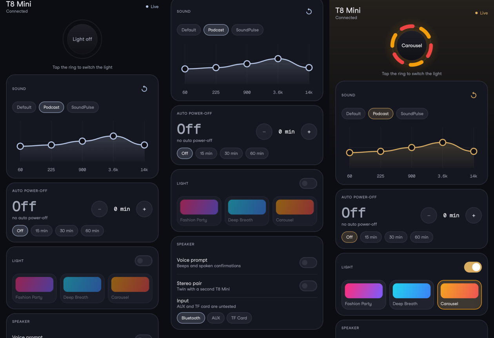

# T8 Mini

An Android controller for the Tronsmart T8 Mini, built with Kotlin and Jetpack Compose. It connects directly over Bluetooth Low Energy, with no account or network permission.



- Switch between Default, SoundPulse and an app-defined Podcast EQ, or adjust five bands by hand.
- Set an auto power-off timer and control the speaker's light, voice prompts and stereo pairing.
- See the [protocol notes](docs/PROTOCOL.md) for the reverse-engineered commands and their verification status.

## Build

Android SDK 36 and JDK 21 are required. The app uses licensed Feixen Standard and Geist fonts that are not included in this repository. Supply `feixen_regular.ttf`, `feixen_bold.ttf` and `geist_regular.ttf` in `app/src/main/res/font/` before building.

```sh
./gradlew :protocol:test :app:assembleDebug
```

For the Docker cloud sandbox workflow, run `./scripts/build.sh` with `sbx` installed. It builds, runs protocol tests and installs the debug APK on a connected Android device.

## Limitations

Battery level and power-off control are unavailable. AUX and TF card switching and stereo pairing have not been verified on hardware. The Podcast curve is a starting point for speech; the speaker's EQ gain scale is unknown.
